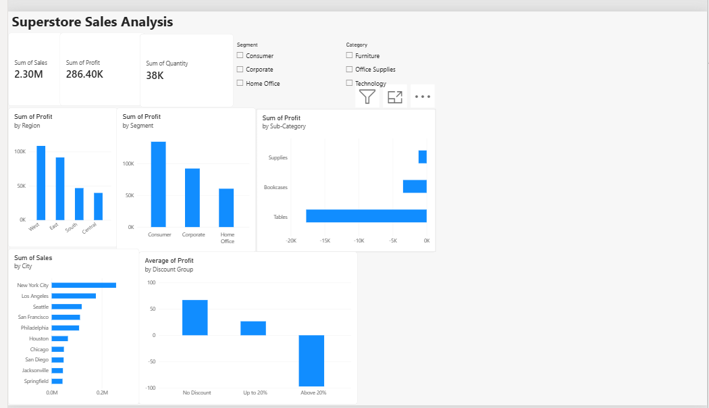

# Superstore Sales Analysis (SQL + Power BI)

An end-to-end analysis of Superstore retail sales data. I used SQL to answer business questions and Power BI to build an interactive dashboard that shows where the business makes and loses money.

## Dashboard



## Tools

- **SQL (SQLite, DB Browser):** aggregation, GROUP BY, HAVING, CASE WHEN, ORDER BY, LIMIT, UNION ALL
- **Power BI Desktop:** KPI cards, bar and column charts, slicers, Top N filter, a DAX calculated column (SWITCH)

## Dataset

The Superstore sales table has 9,994 rows. Columns: Ship Mode, Segment, Country, City, State, Postal Code, Region, Category, Sub-Category, Sales, Quantity, Discount, Profit.

## Business questions

1. Which sub-categories lose money?
2. Which cities generate the most sales?
3. How do the customer segments compare?
4. Which regions and states are the most and least profitable?
5. Does discounting hurt profit?
6. How does performance differ by ship mode?

## Key findings

**Overall:** total sales of about $2.30M, total profit of about $286.4K, and 37,873 units sold.

**1. Heavy discounts lose money.**

| Discount group | Rows | Average profit |
|---|---|---|
| No discount | 4,798 | $66.90 |
| Up to 20% | 3,803 | $26.50 |
| Above 20% | 1,393 | -$97.18 |

Orders with a discount above 20% lose about $97 per row on average.


**2. Three sub-categories are loss-making:** Tables, Bookcases and Supplies. Tables has the largest loss, about $18K.


**3. Consumer is the biggest segment.**

| Segment | Sales | Profit | Quantity |
|---|---|---|---|
| Consumer | $1,161,401 | $134,119 | 19,521 |
| Corporate | $706,146 | $91,979 | 11,608 |
| Home Office | $429,653 | $60,299 | 6,744 |


**4. Region and state differences.**
- West is the most profitable region (about $108K), followed by East. Central is the lowest (about $40K).
- California ($76.4K profit) and New York ($74.0K) lead on profit.
- Texas (-$25.7K) and Ohio (-$17.0K) are loss-making, even though Texas has $170K in sales.

**5. Top cities by sales:** New York City, Los Angeles and Seattle.

## Recommendations

- Limit or review discounts above 20%, because they turn orders into losses.
- Review pricing and costs for Tables, Bookcases and Supplies.
- Investigate why Texas and Ohio lose money. High discounting is one thing to check.

## SQL queries

All queries are in [superstore_queries.sql](superstore_queries.sql). Two examples:

```sql
-- Loss-making sub-categories
SELECT "Sub-Category", sum(Sales) AS total_sales, sum(Profit) AS total_profit
FROM Sales
GROUP BY "Sub-Category"
HAVING sum(Profit) < 0
ORDER BY total_profit ASC;
```

```sql
-- Discount impact on profit
SELECT
  CASE
    WHEN Discount = 0 THEN 'No Discount'
    WHEN Discount <= 0.2 THEN 'Up to 20%'
    ELSE 'Above 20%'
  END AS discount_group,
  count(*) AS num_rows,
  avg(Profit) AS avg_profit
FROM Sales
GROUP BY discount_group
ORDER BY avg_profit DESC;
```

## Files

- `superstore_queries.sql`: all SQL queries
- `Superstore_Dashboard.pbix`: Power BI dashboard file
- `dashboard.png`, `loss_making_subcategories.png`, `discount_vs_profit.png`, `top_cities_by_sales.png`: screenshots

## Validation

I checked the results with totals checks: the segment totals add up to the overall totals, and the discount group row counts add up to 9,994 rows.
